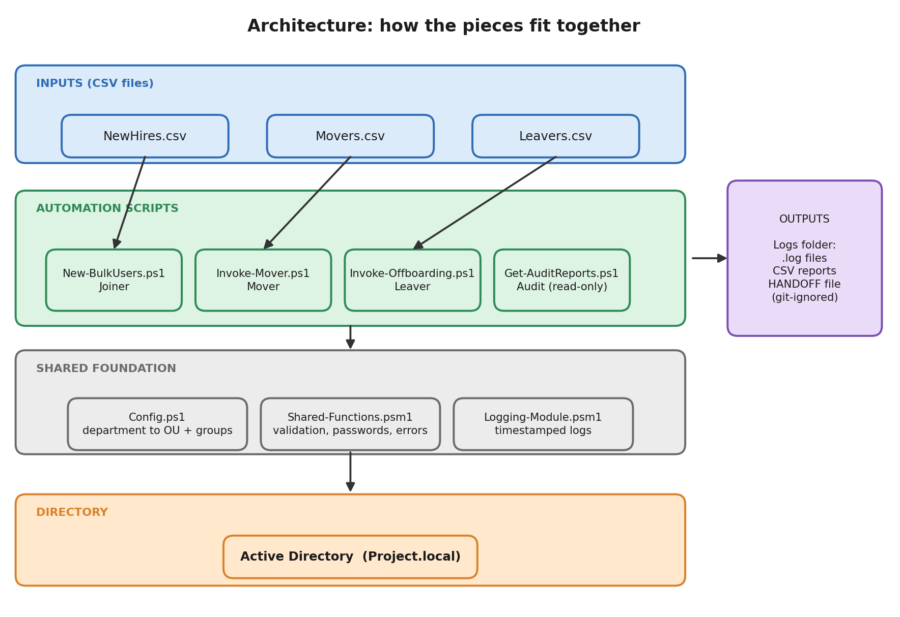
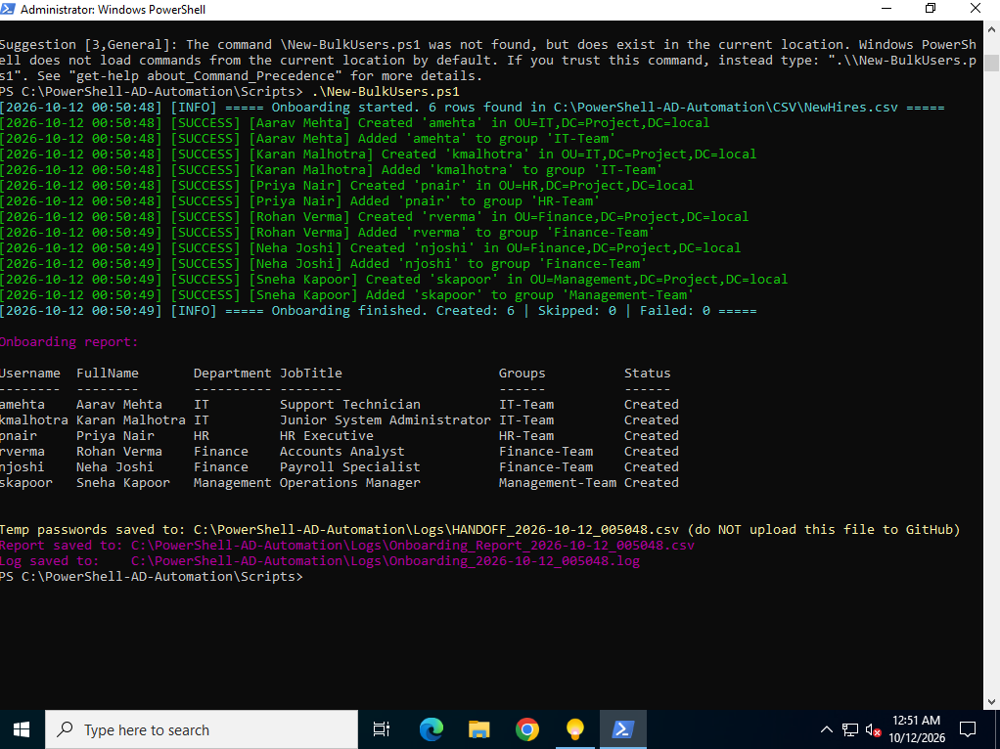
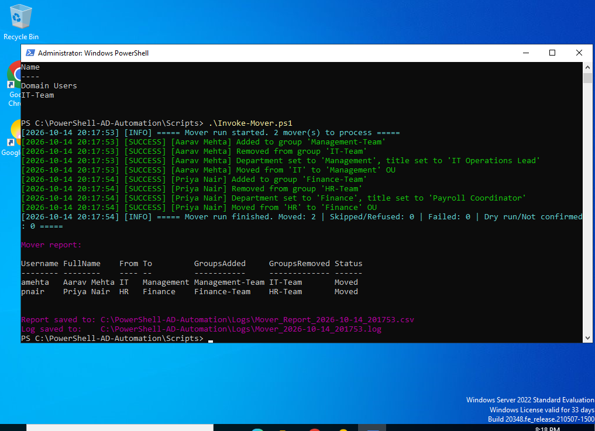
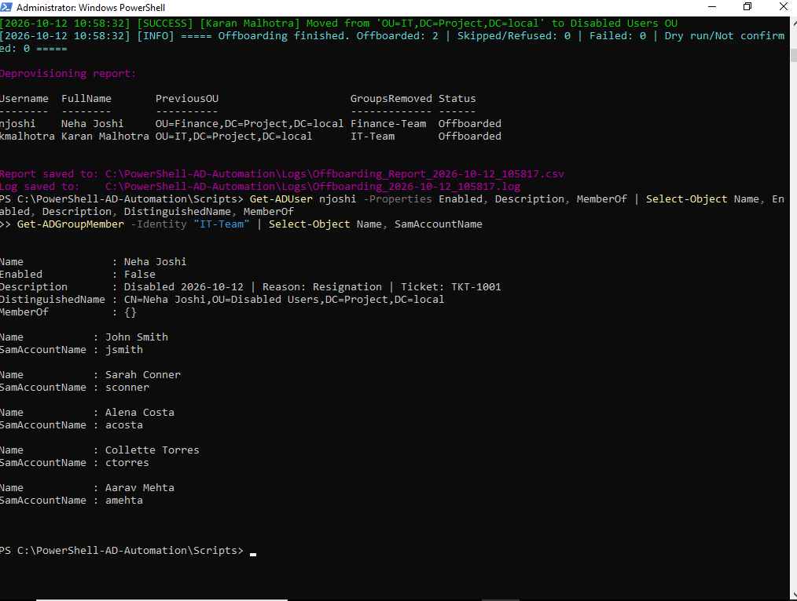
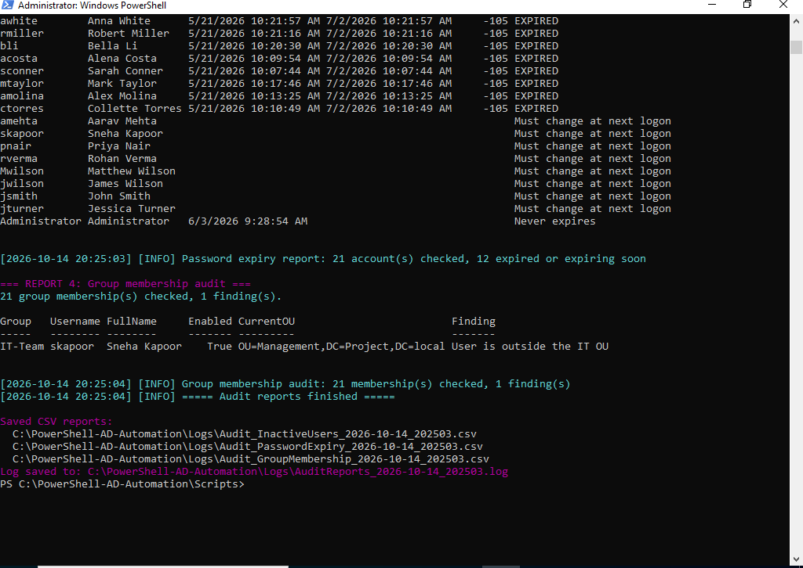
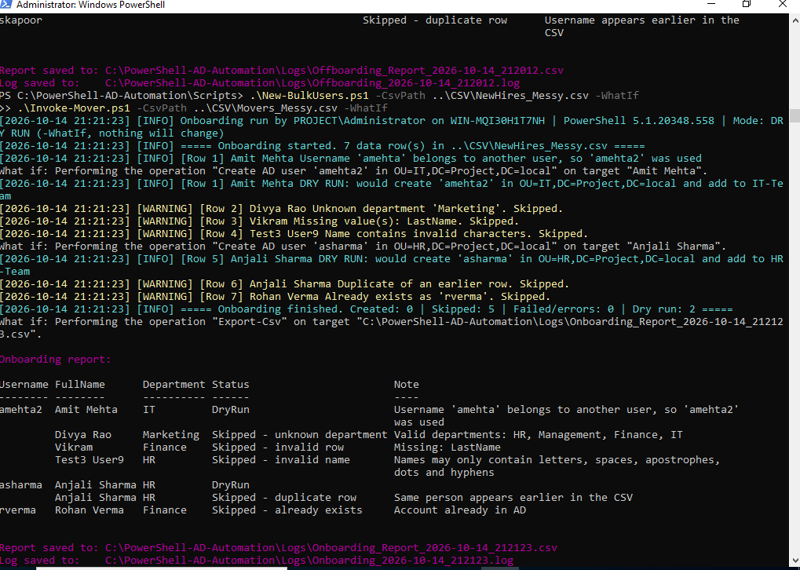

# PowerShell Automation for Active Directory

Automated Joiner-Mover-Leaver workflows and access-review audits for an Active Directory domain, built with PowerShell in a home lab.

- **Author:** Mohd. Ismayeel Khan
- **Date:** October 2026
- **Environment:** VMware Workstation 17 Player | Windows Server 2022 | Windows PowerShell 5.1
- **Domain:** Project.local

---

## Project Overview

This is Project 3 of my IAM and helpdesk portfolio. In Project 1 I built an Active Directory domain and ran the Joiner-Mover-Leaver (JML) lifecycle by hand. In Project 2 I worked through a helpdesk queue and resolved ten tickets. Both left me with one question: how do real IT teams stop doing this account work one click at a time? So I automated it with PowerShell.

The toolkit creates users from a CSV file, moves them between departments, offboards leavers securely and produces the reports an access review needs. Every script supports a dry-run mode, checks its input before touching anything, and leaves a log and a CSV report behind.

It is a lab project. I built and tested it on my own Windows Server 2022 domain (Project.local), not in a production environment.

## Lab Infrastructure

| Component | Details |
|---|---|
| Hypervisor | VMware Workstation 17 Player |
| Domain controller | Windows Server 2022 Standard (evaluation) |
| Domain | Project.local (reused from Project 1) |
| OUs | IT, Finance, HR, Management, Disabled Users |
| Security groups | IT-Team, Finance-Team, HR-Team, Management-Team |
| Shell | Windows PowerShell 5.1 with the ActiveDirectory module |
| Verification | Active Directory Users and Computers (ADUC) |

## Technologies Used

- Windows Server 2022 and Active Directory Domain Services
- PowerShell 5.1: scripts, modules, CSV processing, error handling and logging
- ActiveDirectory PowerShell module (Get-ADUser, New-ADUser, Set-ADUser, Disable-ADAccount, Move-ADObject, Add-ADGroupMember, Remove-ADGroupMember, Search-ADAccount and others)
- VMware Workstation 17 Player
- CSV files as input and report output

## Architecture



CSV files feed four scripts. The scripts share a config file, a logging module and a shared-functions module, they read and change Active Directory, and every run leaves logs and CSV reports behind.

## What the Toolkit Does

| Stage | Script | What it does |
|---|---|---|
| Joiner | `New-BulkUsers.ps1` | Creates users from a CSV, puts each one in the right OU and security group, and sets a random temporary password with a forced change at first sign-in |
| Mover | `Invoke-Mover.ps1` | Adds the new department's group, removes the old one, updates title and department, and moves the account |
| Leaver | `Invoke-Offboarding.ps1` | Disables the account, resets the password to an unknown value, removes all groups, records the reason and ticket, and moves it to Disabled Users. Never deletes |
| Audit | `Get-AuditReports.ps1` | Four read-only reports: inactive users, locked-out accounts, password expiry and group membership |
| Foundation | `Config.ps1`, `Logging-Module.psm1`, `Shared-Functions.psm1`, `Test-Environment.ps1` | Settings, logging, shared helpers and an environment health check |

## Operations Performed

The requests below are simulated. The ticket numbers are recorded in the CSV files and, for leavers, on the disabled accounts.

| Entry | Operation | Date | Script | Result |
|---|---|---|---|---|
| Batch | Joiner: 6 new hires | 12 Oct 2026 | New-BulkUsers.ps1 | 6 accounts created |
| TKT-1001 | Leaver: Neha Joshi (Finance), resignation | 12 Oct 2026 | Invoke-Offboarding.ps1 | Offboarded |
| TKT-1002 | Leaver: Karan Malhotra (IT), end of contract | 12 Oct 2026 | Invoke-Offboarding.ps1 | Offboarded |
| TKT-2001 | Mover: Aarav Mehta, IT to Management | 14 Oct 2026 | Invoke-Mover.ps1 | Moved |
| TKT-2002 | Mover: Priya Nair, HR to Finance | 14 Oct 2026 | Invoke-Mover.ps1 | Moved |
| Audit | Four access-review reports, plus a planted test anomaly | 14 Oct 2026 | Get-AuditReports.ps1 | 20 accounts flagged as never logged on, 12 of 21 passwords expired or expiring, anomaly detected |
| Validation | Messy-CSV tests for all three scripts (dry run) and a re-run | 14 Oct 2026 | All three | Bad rows skipped with a reason, good rows processed |

## Results at a Glance

**Joiner: six users created in the right OUs and groups**



**Mover: new access added, old access removed, title and OU updated**



**Leaver: account disabled, groups removed, reason and ticket recorded, moved to Disabled Users**



**Audit: a test anomaly I planted (a Management user in IT-Team) was detected**



**Validation: messy CSV rows are skipped with a clear reason**



All 25 screenshots are in the [Screenshots](Screenshots) folder and are used inside the documents below.

## Safety Features

- **Dry run first.** `-WhatIf` shows what would happen and changes nothing.
- **Confirmation before destructive actions.** Offboarding asks Yes or No for every user.
- **Disable, never delete.** Offboarded accounts are kept for audits and recovery.
- **Protected accounts.** Administrator, Guest, krbtgt and Domain Admins are refused.
- **Add before remove.** Movers get the new access first, so there is no gap, then lose the old access.
- **Input validation.** Bad CSV rows are skipped with a reason and never stop the good rows.
- **Safe to re-run.** Existing users and already-processed accounts are skipped.
- **Audit trail.** Every run logs who ran it, where and in which mode, and writes a CSV report.
- **Passwords kept out of reports.** Temporary passwords go to a separate hand-off file that is never uploaded.

## Repository Structure

```
PowerShell-AD-Automation/
├── README.md
├── Documents/        Four detailed write-ups (PDF)
├── Screenshots/      All 25 lab screenshots, named CP<checkpoint>-<number>-<description>
├── Scripts/          The 8 PowerShell files
├── CSV/              Sample inputs and three deliberately messy test files
├── Diagrams/         Workflow diagrams (PNG)
└── .gitignore        Blocks the temporary-password hand-off file from being uploaded
```

## Documents

| # | Document | What it covers |
|---|---|---|
| 1 | [Lab Environment and Foundation Overview](Documents/01-Lab-Environment-and-Foundation-Overview.pdf) | Lab setup, tools, architecture, the foundation I built first and how I verified it |
| 2 | [JML Operations Log](Documents/02-JML-Operations-Log.pdf) | The Joiner, Leaver and Mover runs step by step, with screenshots, written like a ticket log |
| 3 | [Audit and Validation Report](Documents/03-Audit-and-Validation-Report.pdf) | The four audit reports and their findings, plus the tests with deliberately broken CSV files |
| 4 | [Runbook and Script Reference](Documents/04-Runbook-and-Script-Reference.pdf) | A reusable guide: procedure, commands, CSV formats, report statuses and troubleshooting |

## Running the Scripts

Keep the `Scripts` and `CSV` folders side by side. Open PowerShell as Administrator on a domain controller (or a machine with the ActiveDirectory module):

```powershell
cd .\Scripts

# 1. Check that Config.ps1 matches your domain (edit the OU and group names first)
.\Test-Environment.ps1

# 2. Always dry-run first. -WhatIf changes nothing
.\New-BulkUsers.ps1 -WhatIf
.\New-BulkUsers.ps1

# Mover and Leaver work the same way
.\Invoke-Mover.ps1 -WhatIf
.\Invoke-Offboarding.ps1 -WhatIf

# Read-only audit reports
.\Get-AuditReports.ps1
```

Config.ps1 contains the OU and group names of my lab, so change them for your own domain. Details for every script are in Document 4.

## Key Skills Demonstrated

- Active Directory administration: users, OUs, security groups and the account lifecycle
- Joiner-Mover-Leaver (JML) workflows and role-based access
- PowerShell scripting: CSV processing, functions, modules, logging and error handling
- Least privilege and prevention of privilege creep
- Secure offboarding: disable, reset, remove access, retain and document
- Access review reporting: inactive accounts, lockouts, password expiry and group audits
- Safe automation: dry runs, confirmations, input validation and re-runnable scripts
- Technical documentation and evidence collection

## Limitations

- Lab only: a single domain and a single domain controller.
- Temporary passwords are saved in a CSV hand-off file. That is fine in a lab, but a real deployment would use a password vault or one-time links.
- The last logon date in Active Directory updates only about every 14 days, so the inactive-user report is approximate.
- There are no automated tests yet, and I have not triggered a real mid-run failure in the lab. The partial-failure reporting describes how the scripts are built.

## How This Was Built

I built this project with an AI assistant (Claude) as my coding partner while I learn PowerShell. I ran every script in my own lab, tested each stage, took the screenshots and documented how it works. I'm getting better at reading and changing the scripts myself with each project.

## Related Projects

- **Project 1:** Active Directory User Management Lab. See my [GitHub profile](https://github.com/IsmayeelKhan77/Helpdesk-IAM-Lab).
- **Project 2:** [Enterprise IT Support Lab](https://github.com/IsmayeelKhan77/Enterprise-IT-Support-Lab)

## Author

Mohd. Ismayeel Khan | GitHub: [IsmayeelKhan77](https://github.com/IsmayeelKhan77) Linkedin: [Ismayeel khan](www.linkedin.com/in/ismayeel-khann7)
